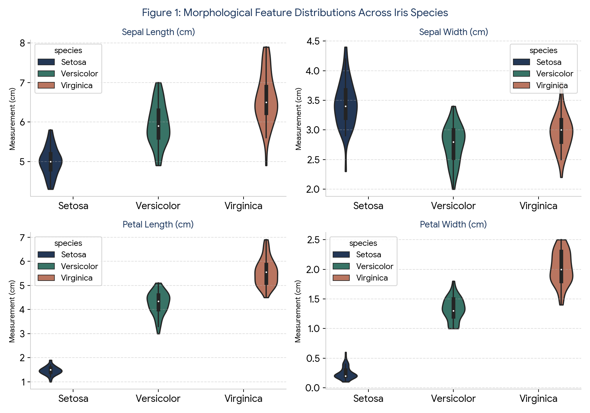
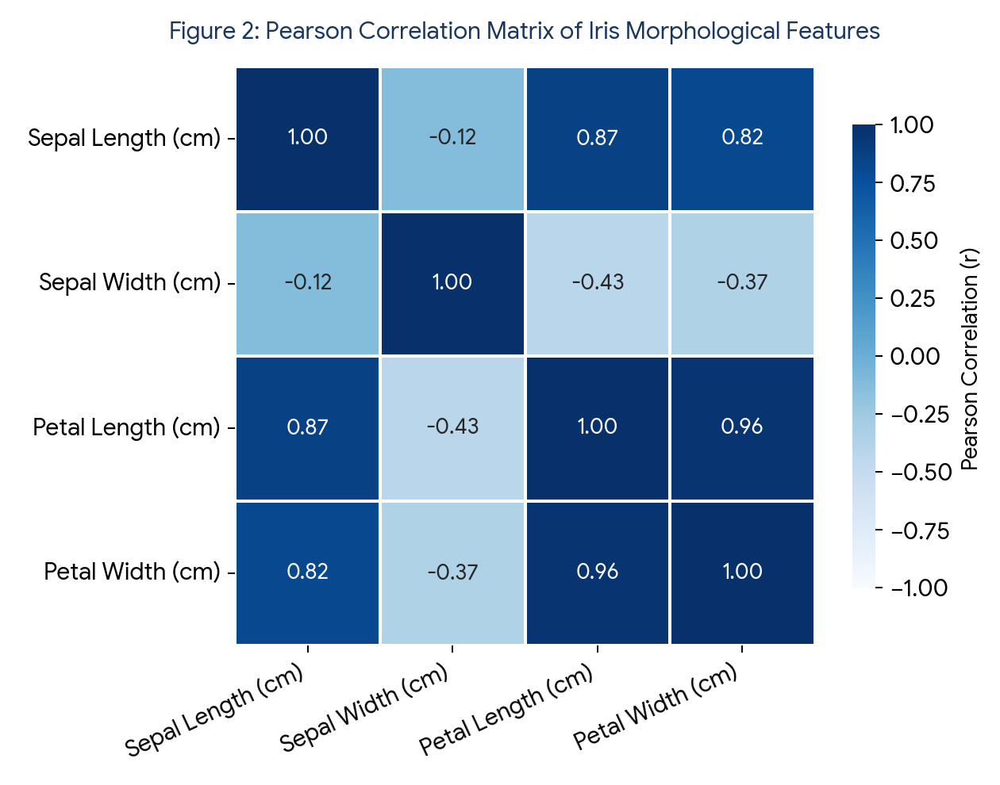
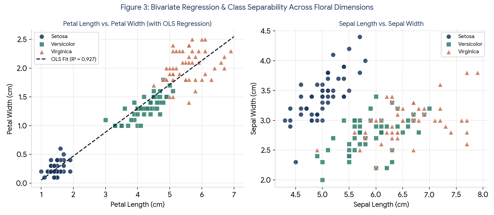
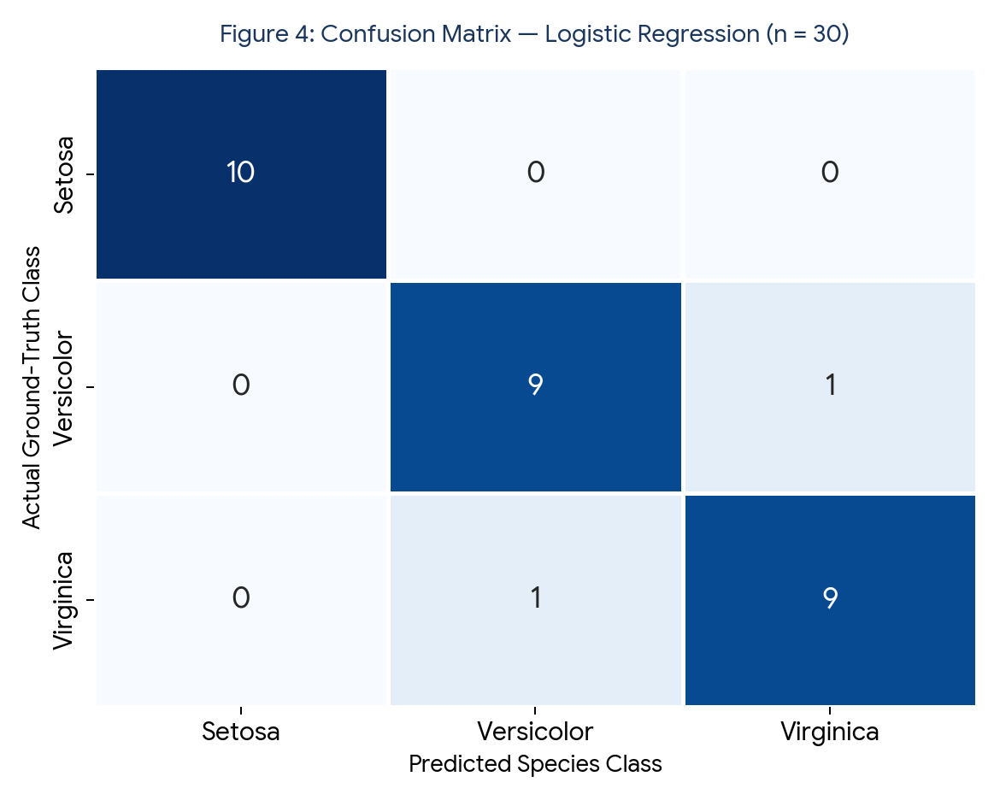
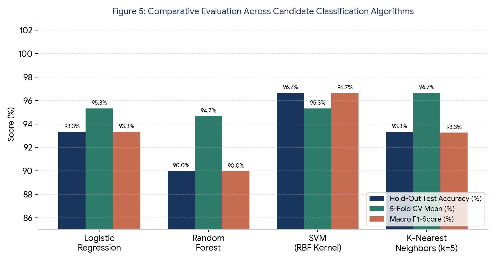
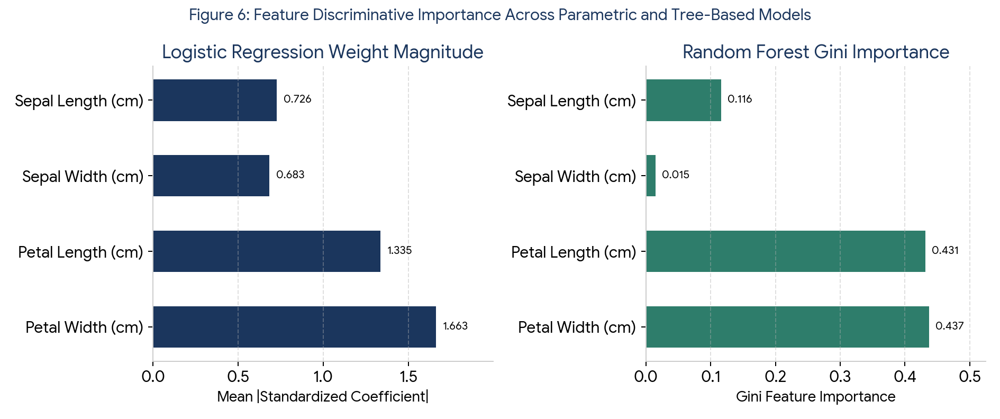

# Iris Botanical Species Classification, Regression & Correlation Analysis

**Author:** Dela Patience Korbla (`PUIT/24120001`)  
**Live Web Application:** [https://iris-classification-iwxp-flame.vercel.app](https://iris-classification-iwxp-flame.vercel.app)  
**Complete Jupyter Notebook:** [`iris_classification_analysis.ipynb`](./iris_classification_analysis.ipynb) *(includes all executable Python code, outputs, regression equations, correlation matrices, and embedded figures)*

---

## Repository Structure

| Artifact | Description |
| :--- | :--- |
| [`iris_classification_analysis.ipynb`](./iris_classification_analysis.ipynb) | Executed Jupyter Notebook containing data ingestion, descriptive statistics, Pearson correlation heatmap, OLS petal allometry regression, Multinomial Logistic Regression training, confusion matrix, and multi-algorithm comparison plots. |
| [`index.html`](./index.html) | Interactive client-side inference web application and visual analytics dashboard hosted on Vercel. |
| `charts/` | High-resolution PNG exports (`fig1_distributions.png` through `fig6_feature_importance.png`) rendered directly in this README and the Jupyter Notebook. |

---

## Summary of Statistical, Regression & Classification Results

### 1. Exploratory Data Analysis & Pearson Correlation
* **Dataset Balance:** 150 specimens distributed evenly across *Iris setosa* (50), *Iris versicolor* (50), and *Iris virginica* (50) with zero missing entries.
* **Strongest Linear Correlation:** `Petal Length (cm)` and `Petal Width (cm)` achieve $r = 0.963$ ($p < 0.001$), followed by `Sepal Length` and `Petal Length` ($r = 0.872$).
* **Ordinary Least Squares (OLS) Petal Allometry Regression:**
  $$\text{Petal Width} = 0.4158 \times \text{Petal Length} - 0.3631 \quad (R^2 = 0.9271)$$





---

### 2. Supervised Model Evaluation & Benchmarking
Evaluated on a stratified 80/20 hold-out split ($n_{\text{train}} = 120$, $n_{\text{test}} = 30$) with leak-free `StandardScaler` preprocessing and **5-fold stratified cross-validation**:

| Classification Algorithm | Hold-Out Accuracy | Macro Precision | Macro Recall | Macro F1-Score | OvR ROC-AUC | 5-Fold CV Mean |
| :--- | :---: | :---: | :---: | :---: | :---: | :---: |
| **Multinomial Logistic Regression (Primary)** | **93.33%** | **93.33%** | **93.33%** | **93.33%** | **99.67%** | **95.33% ± 4.52%** |
| **Support Vector Machine (RBF Kernel)** | 96.67% | 96.97% | 96.67% | 96.66% | 99.67% | 95.33% ± 4.52% |
| **K-Nearest Neighbors ($k = 5$)** | 93.33% | 94.44% | 93.33% | 93.27% | 99.33% | 96.67% ± 3.65% |
| **Random Forest (100 Trees)** | 90.00% | 90.24% | 90.00% | 89.97% | 98.67% | 94.67% ± 2.67% |





---

## How to Run Locally
```bash
git clone [https://github.com/Aquiarh/iris_classification.git](https://github.com/Aquiarh/iris_classification.git)
cd iris_classification
pip install numpy pandas matplotlib seaborn scikit-learn jupyter
jupyter notebook iris_classification_analysis.ipynb